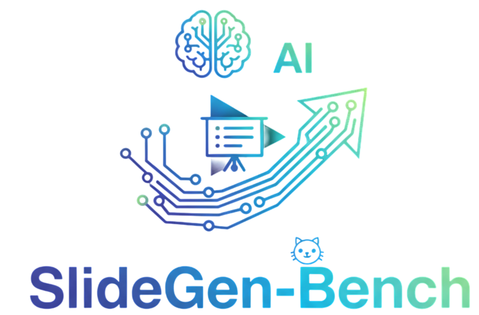
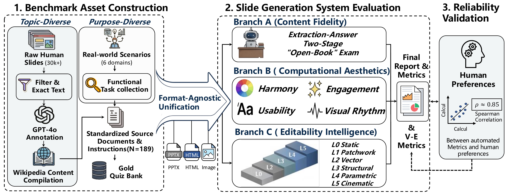
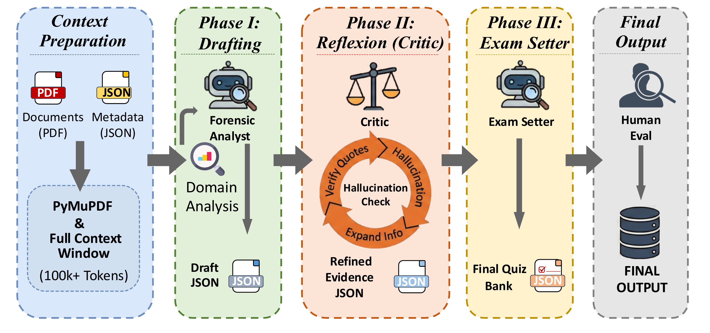
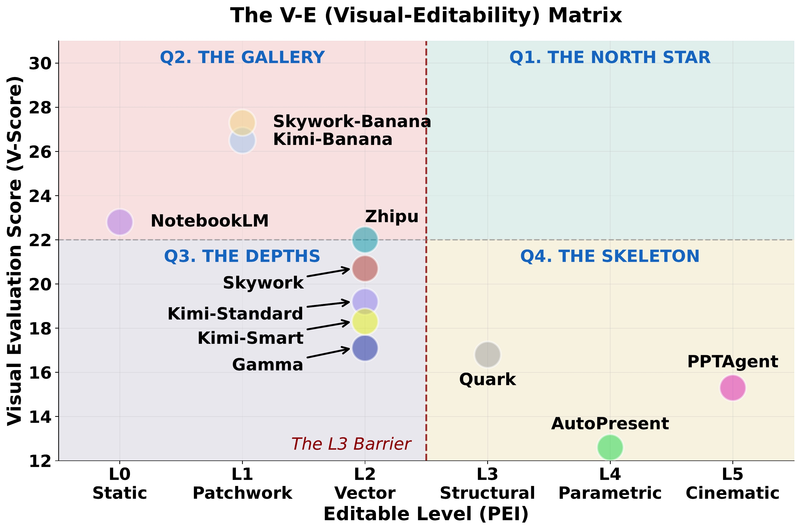

<p align="center">
  
</p>

<p align="center">
  <b>🎯 A Comprehensive Benchmark for Evaluating AI-Generated Presentations</b>
</p>

<p align="center">
  <a href="https://arxiv.org/abs/2601.09487">
    
  </a>
  <a href="https://huggingface.co/datasets/Yqy6/Slides-Align">
    
  </a>
  <a href="https://slidesgenbench.yqy314.top/">
    
  </a>
  <a href="#license">
    
  </a>
</p>

<p align="center">
  <a href="#-abstract">Abstract</a> •
  <a href="#-installation">Installation</a> •
  <a href="#-evaluation-pipeline">Evaluation</a> •
  <a href="#-benchmark-results">Results</a> •
  <a href="#-slides-align15k-dataset">Dataset</a> •
  <a href="#-license">License</a>
</p>

---

## 📖 Abstract

The rapid evolution of Large Language Models (LLMs) has fostered diverse paradigms for automated slide generation, ranging from template-based file generation and code-driven layouts to image-centric synthesis. However, evaluating these heterogeneous systems remains challenging, as existing protocols often struggle to provide comparable scores across architectures or rely on uncalibrated judgments.

In this paper, we introduce **SlidesGen-Bench**, a structured evaluation protocol that assesses slide generation along three practically important dimensions:

| Dimension | Evaluation |
|:---------:|:-----------|
| 📝 **Content Fidelity** | VLM-based **QuizBank** "open-book" exam that quantifies information retention from the source document |
| 🎨 **Visual Aesthetics** | Computational metrics — **Harmony, Engagement, Usability, Visual Rhythm** — grounded in cognitive load theory and visual ergonomics |
| ✏️ **Editability** | **PEI** (Presentation Editability Intelligence), a hierarchical L0–L5 scale via format-conditional structural parsing of the generated files |

To compare heterogeneous systems under one framework, all outputs are projected into the visual domain for content and aesthetic assessment, while editability is evaluated by directly parsing the underlying structural files. Each dimension is quantified with structured, verifiable pipelines rather than monolithic LLM judgment. For the highly subjective aesthetic dimensions, we construct the **Slides-Align1.5k** human preference dataset and show that our computational metrics align with human judgment substantially better than standard LLM-as-a-Judge baselines.

<p align="center">
  
</p>

---

## 🚀 Installation

```bash
# Clone the repository
git clone https://github.com/yunqiaoyang/SlidesGen-Bench.git
cd SlidesGen-Bench

# Install dependencies
pip install -r requirements.txt
```

### 📦 Additional Setup

Configure **PaddleOCR DocLayout Detection** for layout analysis:
- 📖 [PaddleOCR Documentation](https://www.paddleocr.ai/latest/version3.x/module_usage/layout_detection.html#_4)
- We use the `PP-DocLayout_plus-L` model.

📑 PPTX to Image Conversion

For PPTX files, we use **LibreOffice** for conversion:
- 📖 [Official LibreOffice Documentation](https://www.libreoffice.org/get-help/documentation/)

---

## 🔬 Evaluation Pipeline

The benchmark projects all outputs into consistent visual renderings and structural schemas before evaluation. Content and aesthetic evaluation operate on rendered visual outputs (making scores comparable across template-based, code-driven, and image-centric systems), while editability is measured through format-conditional structural parsing.

### 📝 Step 1: Content Evaluation (QuizBank)

Content quality is evaluated with a structured VLM-based **QuizBank** protocol, constructed from the source documents themselves rather than a single black-box LLM prompt.

<details>
<b>🧩 QuizBank Construction</b>

The QuizBank is built by a three-phase multi-agent pipeline on the source documents:

1. **Phase I — Drafting:** A *Forensic Analyst* agent scans the full source document (100k+ tokens) and extracts high-value information into a draft JSON of key points.
2. **Phase II — Critic:** A cyclic feedback loop performs hallucination checks, quote verification, and gap expansion, producing a refined evidence JSON.
3. **Phase III — Exam Setting:** An *Exam Setter* agent converts the evidence into a standardized probe of exactly **10 MCQs per document** — 5 Concept Questions (high-level understanding) and 5 Data Questions (specific details). All questions are manually verified by the authors.

<p align="center">
  
</p>
</details>

<details>
<b>📖 QuizBank Evaluation (Open-Book Exam)</b>

To decouple visual extraction from semantic comprehension, slides are first parsed into structured Markdown by a VLM; the evaluator VLM then answers QuizBank questions relying *solely* on this slide-derived context. Accuracy rates serve as a proxy for content quality. A human audit shows that only **1.2%** of errors stem from VLM extraction failures.

```bash
# Run content evaluation
python eval/quantitative_eval.py --products Kimi-Standard Kimi-Smart Kimi-Banana NotebookLM Quake Zhipu Gamma Skywork Skywork-Banana --source-mode all --eval-mode content_only --use-grids --workers 4

# Calculate quiz accuracy and generate results
python eval/calculate_quiz_accuracy.py --input results/content_eval.json --quiz-data dataset/slidegen-test.json --output results
```
</details>

---

### 🎨 Step 2: Aesthetics Evaluation

#### 📐 Core Aesthetics Metrics

Four computational metrics, grounded in cognitive load theory and visual ergonomics, assess both the *spatial quality* (single slide) and the *temporal coherence* (deck pacing):

| Metric | Description |
|:-------|:------------|
| **Harmony** | 🎨 Fit to harmonic hue templates in HSV space, with a deck-level penalty for cross-slide inconsistency |
| **Engagement** | 🌈 Colorfulness via Hasler & Süsstrunk's opponent-channel method, plus a deck-level pacing score |
| **Usability** | 🔲 Layout-aware figure-ground contrast within detected text regions (WCAG luminance, logarithmic normalization to the 21:1 ratio) |
| **Visual Rhythm** | 📊 **VisualHRV**: subband entropy for per-slide clutter combined with RMSSD for temporal variability |

```bash
python eval/aesthetics_metrics.py IMAGE_PATH [OPTIONS]
```

**Example Usage:**

```bash
python eval/quantitative_eval.py --eval-mode aesthetics_only --products Your_product
```

> 📖 For detailed configuration, see [Aesthetics Configuration Guide](docs/Aesthetics_config.md)

#### 🤖 LLM-as-Judge Methods

We also provide LLM-based evaluation methods (used as baselines in the paper):

| Method | Description |
|:-------|:------------|
| **LLM Rating** | Direct scoring by language models |
| **LLM Arena** | Pairwise comparison with ELO ranking |

> 📖 See [LLM Evaluation Guide](docs/LLM_EVALUATION.md) for detailed documentation

---

### ✏️ Step 3: Presentation Editability Intelligence (PEI)

Evaluate presentation editability with the **PEI** framework — a hierarchical scale from static visual mimicry (L0–L2) to fully editable, narrative presentations (L3–L5), scored with a dependency-based **knockout rule** (failing a lower level precludes credit at higher ones). The benchmark evaluates PEI levels fully automatically by parsing the underlying structural files (Office Open XML schemas via `python-pptx`, DOM trees for HTML).

| Level | Class Name | Technical Hallmark |
|:-----:|:-----------|:-------------------|
| **L5** | Cinematic | Animation logic, native media embeds |
| **L4** | Parametric | Native data objects (`<c:chart>`, SmartArt) |
| **L3** | Structural | Global masters (`<p:sldMaster>`), logical grouping |
| **L2** | Vector | SVG paths, scalable vector primitives |
| **L1** | Patchwork | Editable text, raster backgrounds |
| **L0** | Static | Fully flattened pixels |

> 📄 **Reference:** [PEI Evaluation Protocol](docs/pei.md)

### 👥 Step 4: Reliability Verification via Human Alignment

To verify the reliability of the evaluation scheme, the benchmark integrates a human-preference validation stage on the **Slides-Align1.5k** dataset. Reliability is quantified with three indicators: **Average Spearman correlation**, its **Standard Deviation**, and the **Average Identical ratio**.

---

## 🏆 Benchmark Results

> ⚠️ The reported results are a **dated v1.0 snapshot**: all commercial systems were accessed between November and December 2025. All generated artifacts and scoring scripts are open-sourced to support reruns and versioned updates.

### 📝 Content: QuizBank Accuracy (%)

| Product | Brand Promote | Business Plan | Personal Statement | Product Launch | Course Preparation | Work Report | Topic Intro. | High | Low | Med |
|:--------|:-------------:|:-------------:|:------------------:|:--------------:|:------------------:|:-----------:|:------------:|:----:|:---:|:---:|
| Gamma | 63.57 | 52.50 | 74.00 | 54.44 | 85.00 | 48.46 | 76.34 | 67.26 | 75.56 | 68.45 |
| Kimi-Banana | 84.29 | **77.50** | 96.00 | **90.43** | 84.00 | 85.38 | 86.22 | 83.33 | 91.58 | 86.67 |
| Kimi-Smart | N/A | N/A | 95.00 | N/A | N/A | 84.29 | 79.68 | 78.78 | 88.50 | 78.57 |
| Kimi-Standard | N/A | N/A | **96.47** | N/A | N/A | 80.00 | 76.88 | 75.71 | 88.05 | 75.43 |
| NotebookLM | 83.00 | 45.00 | N/A | 84.21 | **93.00** | 86.15 | 68.33 | 69.81 | 86.00 | 71.16 |
| Quark | 84.29 | 51.25 | 94.00 | 79.05 | N/A | 68.00 | 82.13 | 69.78 | 90.52 | 82.12 |
| Skywork | 80.00 | 68.75 | 78.50 | 76.52 | 84.67 | 86.15 | 83.12 | 80.00 | 82.58 | 81.31 |
| Skywork-Banana | **92.14** | 67.50 | 91.50 | 89.57 | 87.69 | **90.00** | 79.33 | 79.67 | 88.00 | 84.31 |
| Zhipu | 80.00 | 68.75 | 96.00 | 86.08 | 90.00 | 84.17 | **90.44** | **84.07** | **92.00** | **88.97** |
| PPTAgent* | 62.25 | 47.37 | 69.15 | 61.80 | 66.86 | 61.27 | 61.94 | 58.94 | 66.76 | 61.68 |
| AutoPresent* | 56.13 | 42.72 | 62.35 | 55.73 | 60.29 | 55.25 | 55.85 | 53.15 | 60.20 | 55.62 |
| **Average** | **76.19** | **57.93** | **85.30** | **75.31** | **81.44** | **75.37** | **76.39** | **72.77** | **82.70** | **75.84** |

**Zhipu** is the top performer with an overall average of **88.29%**, and is the most robust on High/Medium difficulty content. `N/A` denotes task types not supported by the corresponding system (a true constraint rather than a missing evaluation). 95% bootstrap confidence intervals are typically tight (±2–5%), and an oracle-context QA test (answering from ground-truth source evidence) reaches 100% — observed failures reflect generated-slide content loss rather than evaluator error.

### 🎨 Aesthetics

| Product | Usability ↑ | Engagement ↑ | Harmony ↑ | Rhythm ↑ | Aesthetics ↑ |
|:--------|:-----------:|:------------:|:---------:|:--------:|:------------:|
| **Skywork-Banana** | 5.62 | **8.30** | -0.47 | 13.84 | **27.28** |
| Kimi-Banana | **5.72** | 6.41 | -0.55 | **15.01** | 26.58 |
| NotebookLM | 4.13 | 7.32 | **-0.35** | 11.72 | 22.82 |
| Zhipu | 4.87 | 7.52 | -1.60 | 11.27 | 22.06 |
| Skywork | 4.83 | 7.60 | -1.18 | 9.44 | 20.69 |
| Kimi-Standard | 4.61 | 6.28 | -1.75 | 10.12 | 19.25 |
| Kimi-Smart | 4.13 | 7.99 | -1.88 | 8.06 | 18.30 |
| Gamma | 5.31 | 6.31 | -1.51 | 6.99 | 17.09 |
| Quark | 5.03 | 7.41 | -1.91 | 6.33 | 16.86 |
| PPTAgent* | 5.01 | 6.12 | -1.43 | 5.62 | 15.32 |
| AutoPresent* | 4.28 | 5.93 | -2.15 | 4.57 | 12.63 |

**Skywork-Banana** achieves the highest overall Aesthetics score (27.28), particularly excelling in Engagement (8.30). Style-transfer validation over the 1,435 Slides-Align1.5k records (six style buckets) shows no systematic dark-mode penalty and confirms these metrics are human-aligned proxies within the tested style distribution.

### 🤝 Human Alignment (Slides-Align1.5k)

| Method | Spearman Avg ↑ | Spearman Std ↓ | Identical Avg ↑ |
|:-------|:--------------:|:--------------:|:---------------:|
| **SlidesGen-Bench** | **0.71** | **0.16** | **32.6** |
| LLM-as-Judge Rating | 0.57 | 0.23 | 20.7 |
| LLM-as-Judge Arena | 0.52 | 0.27 | 17.3 |
| PPTAgent (PPT-Eval) | 0.53 | 0.26 | 17.8 |
| **Humans** (gold standard) | **0.85** | **0.12** | **45.3** |

SlidesGen-Bench achieves the highest Average Spearman correlation (0.71), substantially surpassing LLM-as-Judge Rating (0.57) and PPTAgent (0.53), with the most stable performance (Std = 0.16). LLM judges are powered by `gemini-3-flash-preview` taking rendered slide images as direct inputs.

### ✏️ Editability: PEI Levels

| System | T1 | T2 | T3 | T4 | T5 | PEI |
|:-------|:--:|:--:|:--:|:--:|:--:|:---:|
| **PPTAgent*** | ✓ | ✓ | ✓ | ✓ | ✓ | **L5** |
| **AutoPresent*** | ✓ | ✓ | ✓ | ✓ | ✗ | **L4** |
| **Quark** | ✓ | ✓ | ✓ | ✗ | ✗ | **L3** |
| Gamma / Skywork / Kimi (Standard) / Kimi (Smart) / Zhipu | ✓ | ✓ | ✗ | ✗ | ✗ | **L2** |
| Kimi (Banana) / Skywork (Banana) | ✓ | ✗ | ✗ | ✗ | ✗ | **L1** |
| **NotebookLM** | ✗ | ✗ | ✗ | ✗ | ✗ | **L0** |

Most commercial systems achieve Level 2 (Vector Visual) but suffer from **Structural Amnesia** (no global masters). **Quark** is the sole commercial system to breach the "Toy-to-Tool" threshold (L3); the Parametric Gap (L4) is bridged only by open-source academic frameworks (AutoPresent*), while PPTAgent* reaches L5 by inheriting temporal dynamics from raw templates.

<p align="center">
  
</p>

The **V-E Matrix** maps systems by visual aesthetics (x-axis) and editability (y-axis). Commercial systems dominate the left hemisphere (L0–L2), while the lower-right quadrant (Q4) houses Quark, AutoPresent*, and PPTAgent*. The upper-right quadrant (Q1) remains vacant — no current system achieves peak performance in both dimensions simultaneously.

---

## 📊 Slides-Align1.5k Dataset

<p align="center">
  <a href="https://huggingface.co/datasets/Yqy6/Slides-Align">
    
  </a>
</p>

We release **Slides-Align1.5k**, a human preference dataset for evaluating AI-generated slide presentations, constructed as a ground-truth testbed for validating automated evaluation schemes.

<p align="center">
  🤗 <a href="https://huggingface.co/datasets/Yqy6/Slides-Align"><b>huggingface.co/datasets/Yqy6/Slides-Align</b></a>
</p>

### 📈 Dataset Statistics

<table align="center">
  <tr>
    <td align="center"><b>📊 Human Preference Rankings</b><br>~1,500</td>
    <td align="center"><b>🏢 Systems Evaluated</b><br>11 (9 commercial + 2 academic)</td>
    <td align="center"><b>📂 Scenario Categories</b><br>7</td>
    <td align="center"><b>💡 Benchmark Instructions</b><br>189</td>
  </tr>
</table>

### 📝 Benchmark Instruction Distribution

The benchmark contains **189** curated instructions, each a complex, document-level synthesis task (mean: 4,525 characters, requiring multi-modal image integration):

| Category | Instructions | Description |
|:---------|:---:|:------------|
| `topic_introduction` | 94 | 📚 General topic introductions (AI, Climate Change, 5G, etc.) |
| `product_launch` | 24 | 🚀 Product launch announcements |
| `personal_statement` | 20 | 👤 Personal statements and self-introductions |
| `brand_promote` | 15 | 📢 Brand promotion and marketing |
| `course_preparation` | 15 | 🎓 Educational course materials |
| `work_report` | 13 | 📊 Work progress reports |
| `business_plan` | 8 | 💼 Business plan presentations |

Instructions are further stratified into three balanced **Content Richness** levels (Low / Medium / High, 63 each), where "High" richness demands organizing 7,500+ characters and 20+ images into cohesive decks.

### 🏢 Systems Evaluated

The evaluated systems span three generation paradigms:

1. **Source File Generation** — directly outputs standard `.pptx` files (template-filling or code-centric manipulation).
2. **HTML Code Generation** — LLMs synthesize structural code (HTML/CSS/JS) for superior typographic precision.
3. **Image Generation** — multi-modal models generate slides directly as images.

| Product | Provider | Paradigm | Description |
|:--------|:---------|:---------|:------------|
| **Gamma** | Gamma.com.ai | Source file (template) | 🎨 AI presentation maker |
| **Quark PPT** | Quark AI | Source file (template) | ⚡ Quark presentation tool |
| **Kimi-Standard** | Moonshot AI | Source file (template) | 🌙 Kimi-PPT (standard mode) |
| **Kimi-Smart** | Moonshot AI | Source file (template) | 🧠 Kimi-PPT (smart mode) |
| **Zhipu** | Zhipu AI | HTML code generation | 🤖 Presentation generator |
| **Skywork** | SKYWORK.ai | HTML code generation | 🌤️ Skywork AI |
| **NotebookLM** | Google | Image generation | 📓 AI notebook with presentation generation |
| **Skywork-Banana** | SKYWORK.ai | Image generation | 🍌 Skywork (Banana mode) |
| **Kimi-Banana** | Moonshot AI | Image generation | 🍌 Kimi (Banana mode) |
| **PPTAgent*** | Academic (open-source) | Source file (template) | 🎓 Adapted academic framework |
| **AutoPresent*** | Academic (open-source) | Source file (code) | 🎓 Adapted academic framework |

*Adapted open-source pipelines (marked with `*`) were augmented with LLM pre-processing/routing to run under the benchmark's zero-shot, end-to-end setting.*

### 👤 Human Annotation

- **Diverse annotator pool**: CS Ph.D. students, art undergraduates, and office clerks, providing technical, aesthetic, and end-user perspectives.
- **Ranking interface**: a web-based annotation interface presents high-resolution rendered slide images from competing systems for the same input; annotators rank decks from best to worst (relative ranking rather than absolute scores).
- **High agreement**: inter-annotator agreement reaches an Average Spearman correlation of **0.85** (Std = 0.12), serving as a reliable gold standard.

### 📝 Annotation Format

<details>
<summary>Click to expand annotation example</summary>

```json
{
    "results": [
        {
            "product": "NotebookLM",
            "difficulty": "topic_introduction",
            "topic": "FinTech",
            "rank": 1
        },
        ...
    ]
}
```

</details>

### 💻 Usage

```python
from datasets import load_dataset

# Load from Hugging Face
dataset = load_dataset("Yqy6/Slides-Align")

# Access the data
for item in dataset['train']:
    print(f"{item['product']} - {item['topic']}: Rank {item['rank']}")
```

---

## 🔧 Adding Your Own Products

You can easily extend SlidesGen-Bench to evaluate your own slide generation product by following these steps:

### 1️⃣ Configure Product Settings

Add your product configuration to `eval/eval_config.py` in the `PRODUCTS` dictionary:

```python
PRODUCTS = {
    # ... existing products ...
    "YourProduct": {
        "directory": "YourProduct",           # Folder name in ppt_gen_root
        "input_format": "pptx",               # Format: "pptx" or "pdf"
        "description": "Your product description",
        "structure": "difficulty/topic/name", # Directory structure
        "has_slide_images": False,            # Set True if images pre-extracted
    },
}
```

### 2️⃣ Organize Your Slides

Structure your generated slides following the specified format:

```
ppt_gen_root/
└── YourProduct/
    └── {difficulty}/              # e.g., topic_introduction, work_report
        └── {topic}/               # e.g., AI, Climate_Change
            └── slides.pptx        # Your generated presentation
```

**Supported difficulties:**
- `topic_introduction`
- `work_report`
- `business_plan`
- `brand_promote`
- `personal_statement`
- `product_launch`
- `course_preparation`

### 3️⃣ Preprocess Slides

Convert your slides to images for unified evaluation:

```bash
# For PPTX files
python eval/pre_process.py --ppt-gen-root ./your_slides_folder --products YourProduct

# For custom formats, adapt the conversion script:
# python eval/process_custom.py --product-dir your_product_dir
```

### 4️⃣ Run Evaluation

Evaluate your product using the benchmark:

```bash
# Content evaluation
python eval/quantitative_eval.py \
  --products YourProduct \
  --eval-mode content_only \
  --workers 4

# Aesthetics evaluation
python eval/quantitative_eval.py \
  --products YourProduct \
  --eval-mode aesthetics_only

# Full evaluation
python eval/quantitative_eval.py \
  --products YourProduct \
  --source-mode all \
  --workers 4
```

### 📌 Tips

- ✅ Ensure slide images are stored in `{ppt_path}_images/` folders
- ✅ Use consistent naming conventions across topics
- ✅ Set `has_slide_images: True` if you've already extracted slide images
- ✅ Test with a small subset before running full evaluation

---

## ⚙️ Configuration

Configuration options can be set via:
- 📝 Config file: `eval/eval_config.py`
- 💻 Command-line arguments

---

## 📄 Citation

If you find SlidesGen-Bench useful in your research, please consider citing our paper:

```bibtex
@misc{yang2026slidesgenbenchevaluatingslidesgeneration,
      title={SlidesGen-Bench: Evaluating Slides Generation via Computational and Quantitative Metrics}, 
      author={Yunqiao Yang and Wenbo Li and Houxing Ren and Zimu Lu and Ke Wang and Zhiyuan Huang and Zhuofan Zong and Mingjie Zhan and Hongsheng Li},
      year={2026},
      eprint={2601.09487},
      archivePrefix={arXiv},
      primaryClass={cs.CL},
      url={https://arxiv.org/abs/2601.09487}, 
}
```

---

## 📜 License

This project is licensed under the MIT License - see the [LICENSE](LICENSE) file for details.

---

<p align="center">
  <i>If you find SlidesGen-Bench useful, please consider giving us a ⭐!</i>
</p>
